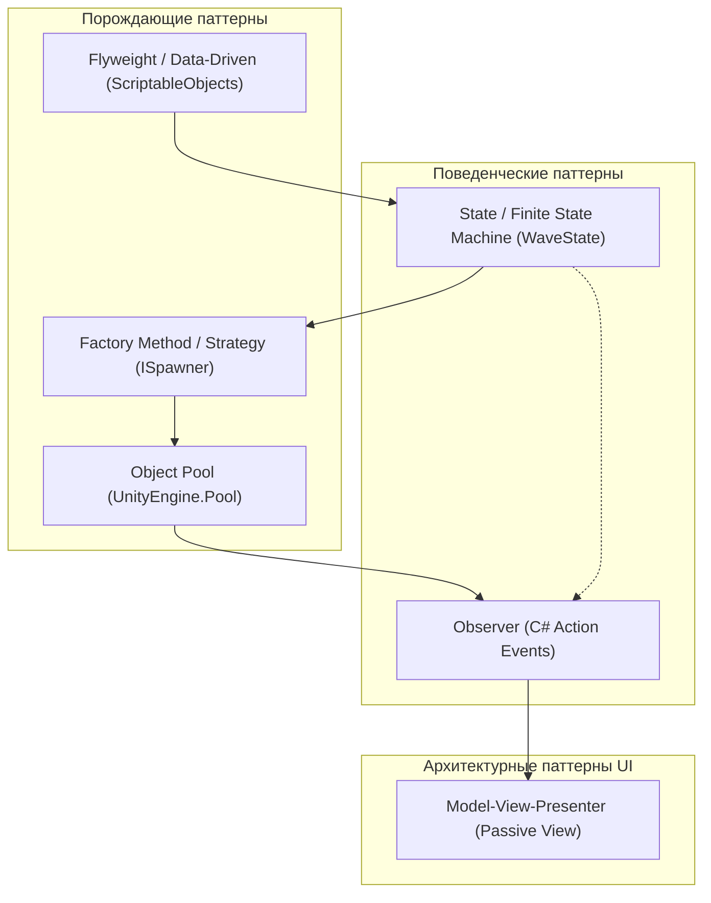

# Архитектурный гид и защита решений: Wave Spawner

Документ подготовлен для подготовки к техническому интервью и live-coding сессии в компании **Mind Studios Games**. Включает исчерпывающий разбор каждого скрипта, явную привязку к принципам **SOLID**, каталогу паттернов **GoF** и архитектурным шаблонам корпоративного уровня, а также анализ спорных компромиссов.

---

## 🏛 1. Матрица применения принципов SOLID в проекте

| Принцип SOLID | Где и как реализован в коде | Что это дает проекту |
| :--- | :--- | :--- |
| **S — Single Responsibility (Единственная ответственность)** | • `WaveConfig` — только хранение и валидация данных. • `Enemy` — только жизненный цикл одного врага и коллайдер. • `EnemySpawner` — только размещение и пул объектов. • `WaveController` — только фазы волн и тайминги. • `ClickRaycastController` — только преобразование клика в рейкаст. • `WaveUIView` — только визуальное обновление UI. • `WaveUIPresenter` — только синхронизация событий между моделью и вью. | Изменение логики UI никогда не затронет геймплей. Изменение механики урона никогда не сломает спавнер. |
| **O — Open/Closed (Открытость к расширению, закрытость к модификации)** | • Конфигурации волн вынесены в `ScriptableObject`: добавление 10 новых волн не требует изменения кода. • `EnemySpawner` принимает `prefabOverride`: можно спавнить боссов и элитных врагов без переписывания спавнера. • `ClickRaycastController` работает через `IDamageable`: в игру можно добавить взрывающиеся бочки или ящики, не трогая скрипт ввода. | Новые фичи добавляются созданием новых ассетов и классов, а не переписыванием старого кода. |
| **L — Liskov Substitution (Подстановка Барбары Лисков)** | • `Enemy` полностью заменяет абстракцию `IDamageable`. Любой объект с `IDamageable` гарантированно корректно уничтожается при вызове `Kill()`. • `WaveUIView` полностью реализует контракт `IWaveUIView`. Презентер может работать с любой реализацией View (хоть на UI Toolkit, хоть с моком в тестах). | Взаимозаменяемость компонентов без скрытых побочных эффектов. |
| **I — Interface Segregation (Разделение интерфейсов)** | • `IDamageable` содержит ровно один метод `void Kill();`. Он не перегружен лишними методами вроде `GetHealth()`, `TakeDamage()`, `Heal()`, которые не требуются для кликабельного уничтожения. • `ISpawner` содержит только `SpawnEnemy()`. • `IWaveUIView` содержит только методы отображения UI. | Классы не вынуждены реализовывать методы, которые им не нужны. |
| **D — Dependency Inversion (Инверсия зависимостей)** | • `ClickRaycastController` зависит от интерфейса `IDamageable`, а не от конкретного класса `Enemy`. • `WaveUIPresenter` зависит от абстрактного контракта `IWaveUIView`. • Связь между `Enemy` и `WaveController`, а также между `WaveController` и `WaveUIPresenter` построена на стандартных C# событиях (`Action`), а не на жестких ссылках. | Модули верхних уровней не зависят от деталей нижних уровней. Связность (Coupling) минимальна. |

---

## 🧩 2. Каталог примененных паттернов проектирования (Design Patterns)

1. **Object Pool (Пул объектов — GoF Creational):**
   - *Где:* `EnemySpawner.cs` через `UnityEngine.Pool.ObjectPool<Enemy>`.
   - *Зачем:* Предотвращает циклические вызовы `Instantiate` и `Destroy`, сводя нагрузку на Garbage Collector к **0 B в рантайме**.
2. **Observer (Наблюдатель — GoF Behavioral):**
   - *Где:* `Enemy.OnDied`, `WaveController.OnWaveStarted`, `OnEnemiesCountChanged`, `OnAllWavesCompleted`.
   - *Зачем:* Чистая событийная модель без циклической связности. Модель публикует события, а внешние системы реагируют без прямого контроля над отправителем.
3. **State / Finite State Machine (Конечный автомат — GoF Behavioral):**
   - *Где:* `WaveState.cs` и `WaveController.cs`.
   - *Зачем:* Явный детерминированный цикл жизни волны (`Idle` $\rightarrow$ `Spawning` $\rightarrow$ `WaitingForClear` $\rightarrow$ `WaveCompletedDelay` $\rightarrow$ `AllWavesCompleted`) вместо запутанных булевых флагов в `Update()`.
4. **Model-View-Presenter: Passive View (Архитектурный паттерн корпоративного UI):**
   - *Где:* `WaveController` (Model), `WaveUIView` (View), `WaveUIPresenter` (Presenter).
   - *Зачем:* Абсолютная изоляция визуального слоя от игровой логики. View ничего не знает о волнах и спавне.
5. **Strategy / Factory Method (Стратегия / Фабричный метод — GoF):**
   - *Где:* `ISpawner` и `EnemySpawner.cs`.
   - *Зачем:* Алгоритм создания и позиционирования врагов инкапсулирован отдельно от контроллера волн.
6. **Flyweight / Data-Driven Configuration (Легковес / Данные отдельно от логики):**
   - *Где:* `WaveConfig` и `WaveSequenceConfig`.
   - *Зачем:* Общие неизменяемые параметры волн хранятся в единственном экземпляре в ассетах проекта, не дублируясь в памяти сцены.
7. **Fallback / Graceful Degradation (Защитный спад):**
   - *Где:* `EnemySpawner.cs` (если точки спавна не заданы — используется позиция самого спавнера; если пул отключен — работает обычный `Instantiate`).

---

## 🔍 3. Пофайловый разбор системы (Deep Dive)

### 3.1. `WaveConfig.cs` (Data Layer)
- **Ответственность (SRP):** Хранение и валидация неизменяемых числовых параметров отдельной волны (`EnemyCount`, `SpawnInterval`, `DelayBeforeNextWave`).
- **Примененные паттерны:** *Flyweight*, *Data-Driven Design*.
- **Принципы SOLID:** 
  - **S:** Класс содержит только структуру данных и проверку границ.
  - **O:** Параметры можно расширять (добавлять оверрайды префабов, кривые сложности), не ломая существующие волны.
- **Защитное программирование:**
  - Атрибуты `[Min(1)]`, `[Min(0.05f)]`, `[Min(0f)]` на уровне сериализатора.
  - Метод `OnValidate()` для принудительного отсечения некорректных значений в редакторе при ручном вводе.
  - Доступ наружу строго через публичные read-only геттеры (`EnemyCount => _enemyCount;`).

---

### 3.2. `WaveSequenceConfig.cs` (Data Layer)
- **Ответственность (SRP):** Хранение последовательности волн уровня и безопасная выдача элементов по индексу.
- **Примененные паттерны:** *Data-Driven Configuration*.
- **Принципы SOLID:**
  - **S:** Отвечает исключительно за упорядоченный список конфигураций уровня.
  - **I / D:** Инкапсулирует приватный список через `IReadOnlyList<WaveConfig>` — вызывающий код не может случайно сделать `_waves.Clear()` или `_waves.Add()`.
- **Защитное программирование:**
  - Метод `GetWave(int index)` производит проверку диапазона `[0..Count - 1]` с информативным `Debug.LogWarning` и возвратом `null`, исключая `IndexOutOfRangeException` в рантайме.

---

### 3.3. `IDamageable.cs` (Enemies Layer)
- **Ответственность (SRP):** Контракт для сущностей, способных получать смертельное воздействие.
- **Принципы SOLID:**
  - **I (Interface Segregation):** Содержит только `void Kill();`. Нет лишней шелухи, интерфейс предельно атомарен.
  - **D (Dependency Inversion):** Позволяет контроллерам ввода и внешним системам взаимодействовать с объектами через абстракцию, не зная конкретного типа.

---

### 3.4. `Enemy.cs` (Enemies Layer)
- **Ответственность (SRP):** Управление состоянием отдельного врага, обработка гибели, взаимодействие с пулом объектов.
- **Примененные паттерны:** *Observer* (событие `OnDied`), *Pooled Object* (методы `ResetEnemy`, `Init`).
- **Принципы SOLID:**
  - **S:** Враг отвечает только за себя. Он не знает, кто его заспавнил, в какой он волне и сколько врагов осталось.
  - **L:** Корректно реализует `IDamageable`.
- **Защитное программирование и оптимизация:**
  - **Атрибут `[DisallowMultipleComponent]`:** Защита от случайного добавления двух скриптов врага на один объект.
  - **Кэширование коллайдера:** В `Awake()` кэшируется `_collider = GetComponent<Collider>();`, что устраняет накладные расходы на `TryGetComponent` при каждом извлечении из пула.
  - **Защита от Race Condition (Double-Hit):** Флаг `_isDead` и немедленное отключение `_collider.enabled = false` в момент вызова `Kill()` блокируют повторное попадание луча в том же кадре при спаме кликов.
  - **Предотвращение утечек памяти:** Очистка делегатов `OnDied = null;` перед возвратом в пул и в `OnDestroy()`.

---

### 3.5. `ISpawner.cs` & `EnemySpawner.cs` (Spawning Layer)
- **Ответственность (SRP):** Инстанцирование, переиспользование из пула и позиционирование врагов на сцене.
- **Примененные паттерны:** *Object Pool* (`UnityEngine.Pool`), *Factory Method* (`ISpawner`), *Strategy* (Round-Robin перебор точек), *Fallback Pattern*.
- **Принципы SOLID:**
  - **S:** Отвечает исключительно за создание объектов и их координаты. Не содержит логики волн.
  - **O:** Метод `SpawnEnemy(Enemy prefabOverride = null)` открыт для появления новых типов префабов.
  - **D:** Контроллер волн взаимодействует со спавнером через интерфейс.
- **Архитектурные фичи:**
  - **UnityEngine.Pool.ObjectPool<Enemy>:** Официальный пул Unity 6 с проверкой на дублирование возврата (`collectionCheck: true`), инициализацией емкости и максимального размера.
  - **Round-Robin:** Равномерный циклический перебор точек спавна с защитой от изменения размера массива в рантайме.
  - **Scene Gizmos:** Визуализация точек спавна, векторов направления и номеров через `Handles.Label` под `#if UNITY_EDITOR`.

---

### 3.6. `WaveState.cs` & `WaveController.cs` (Waves Layer)
- **Ответственность (SRP):** Оркестрация жизненного цикла волн, переключение состояний, учет живых врагов и публикация событий прогресса.
- **Примененные паттерны:** *Finite State Machine (FSM / State)*, *Observer*, *Mediator*.
- **Принципы SOLID:**
  - **S:** Управляет только потоком волн. Не знает ничего про UI, рендеринг, ввод игрока.
  - **O:** Легко расширяется новыми состояниями (например, `BossIntro`, `WavePaused`).
  - **D:** Общается с внешним миром исключительно через C# `Action` события (`OnWaveStarted`, `OnEnemiesCountChanged`, `OnAllWavesCompleted`).
- **Защитное программирование и производительность:**
  - **Zero-Allocation Loop:** Ожидание уничтожения волны реализовано через цикл `while (_aliveEnemiesCount > 0) yield return null;`, что исключает аллокацию лямбды и объекта `WaitUntil` в куче.
  - **Защита от утечек подписок:** Список `_activeEnemies` отслеживает всех живых врагов; в `OnDestroy()` контроллер гарантированно отписывается от всех активных делегатов.
  - **Метод `Init(...)`:** Добавлен метод явной инициализации зависимостей, позволяющий инжектить спавнер и конфиг из Unit-тестов или DI-контейнера без запуска сцены.

---

### 3.7. `ClickRaycastController.cs` (Player Layer)
- **Ответственность (SRP):** Преобразование пользовательского ввода (клик/тап) в физический луч и вызов действия уничтожения.
- **Примененные паттерны:** *Command / Interactor*.
- **Принципы SOLID:**
  - **S:** Отвечает только за ввод. Не содержит логики смерти, подсчета врагов или UI.
  - **D:** Вызывает `damageable.Kill()`, оперируя исключительно абстракцией `IDamageable`.
- **Архитектурные фичи:**
  - **Unity New Input System:** `Pointer.current.press.wasPressedThisFrame` универсально обрабатывает мышь, тачскрины смартфонов и стилусы.
  - **UI Raycast Blocking:** `EventSystem.current.IsPointerOverGameObject()` предотвращает случайное уничтожение врага при клике на элементы меню или интерфейса.
  - **Поддержка иерархических хитбоксов:** `hit.collider.GetComponentInParent<IDamageable>()` находит компонент врага, даже если коллайдер находится на дочерней кости составной 3D-модели.

---

### 3.8. `IWaveUIView.cs`, `WaveUIView.cs`, `WaveUIPresenter.cs` (UI Layer - Strict MVP)
- **Ответственность (SRP):**
  - `IWaveUIView` — контракт отображения интерфейса.
  - `WaveUIView` (Passive View) — визуализация данных на `TextMeshProUGUI`, управление экраном победы. **0 зависимостей от геймплея**.
  - `WaveUIPresenter` — посредник (Presenter). Слушает события `WaveController` и передает данные во View.
- **Примененные паттерны:** *Model-View-Presenter (Passive View)*, *Observer*.
- **Принципы SOLID:**
  - **S:** Разделение логики подписок/форматирования (Presenter) и верстки/стилей (View).
  - **O:** Замена TextMeshPro на UI Toolkit требует только новой реализации `IWaveUIView`, презентер не меняется.
  - **L:** `WaveUIView` взаимозаменяем с любым другим `IWaveUIView`.
  - **D:** Презентер связан с View через контракт интерфейса.
- **Защитное программирование:**
  - Полная герметичность: все поля View приватные сериализованные, никаких публичных утечек ссылок на компоненты TMP.
  - Подписка в `OnEnable()`, отписка в `OnDisable()` и `OnDestroy()`, синхронизация при повторной активации UI в разгаре волны.

---

### 3.9. `WaveSpawnerSceneSetup.cs` (Editor Tooling)
- **Ответственность (SRP):** Автоматизация генерации ассетов, префабов и сборки сцены в один клик.
- **Примененные паттерны:** *Builder*, *Facade*.
- **Принципы SOLID:**
  - **S:** Только утилита редактора. Полная изоляция директивой `#if UNITY_EDITOR ... #endif`.
- **Ценность:** Исключает риск забытых ссылок в инспекторе. Ревьюер разворачивает проект за 5 секунд через `Tools -> Wave Spawner -> Setup Assets and Scene`.

---

## 🎯 4. Защита архитектурных компромиссов на интервью

### Вопрос 1: «Почему вы сделали строгий MVP на экране с двумя текстовыми полями? Это оверинжиниринг?»
> **Ответ:**  
> *«Для изолированного прототипа из одного окна разделение на View и Presenter действительно можно счесть микро-оверинжинирингом — там хватило бы компактного Event-Driven Controller.  
> Однако цель тестового задания — показать, как я проектирую системы для масштабируемого продакшена. Разделение на Passive View и Presenter гарантирует, что UI-артист или верстальщик может полностью переверстать префаб Canvas, не создавая merge-конфликтов в Git с геймплейными программистами. Кроме того, этот код на 100% готов к внедрению Zenject/VContainer: Presenter за 2 минуты превращается в чистый C# класс с `IInitializable, IDisposable`, а View инжектится через интерфейс `IWaveUIView`»*.

### Вопрос 2: «Почему корутины (`IEnumerator`), а не `async/await` или `UniTask`?»
> **Ответ:**  
> *«По условиям ТЗ сторонние библиотеки были запрещены, что исключало подключение `UniTask`. Стандартный Task-based асинхронный подход (`async/await`) в Unity без сторонних обвязок сложнее синхронизировать с `Time.timeScale` (паузой игры) и требует ручной проброски `CancellationToken`.  
> Корутины встроены в ядро Unity, работают синхронно в основном потоке, нативно учитывают `timeScale` и автоматически прекращают выполнение при деактивации или уничтожении объекта»*.

### Вопрос 3: «Зачем использовать `UnityEngine.Pool`, если в ТЗ всего 3 волны и несколько кубиков?»
> **Ответ:**  
> *«Я заложил production-ready паттерн. В реальной игре волн могут быть десятки, а врагов — сотни. Постоянный `Instantiate/Destroy` фрагментирует кучу и вызывает спайки Garbage Collector. Официальный `UnityEngine.Pool.ObjectPool` из современных версий Unity потокобезопасен, проверяет коллекцию на ошибки и сводит GC Allocations в рантайме к абсолютному нулю»*.

### Вопрос 4: «Почему клик обрабатывается через физический рейкаст в контроллере, а не через `IPointerClickHandler` на префабе врага?»
> **Ответ:**  
> *«Использование `IPointerClickHandler` потребовало бы вешать `PhysicsRaycaster` на Main Camera и размывало бы ответственность: сущность врага начинала бы отвечать за перехват событий клика игрока. Выделение отдельного `ClickRaycastController` соблюдает Single Responsibility: враг отвечает только за получение урона (`IDamageable`), а контроллер ввода отвечает за лучи, слои (`LayerMask`) и отсечение кликов сквозь элементы интерфейса (`IsPointerOverGameObject`)»*.
