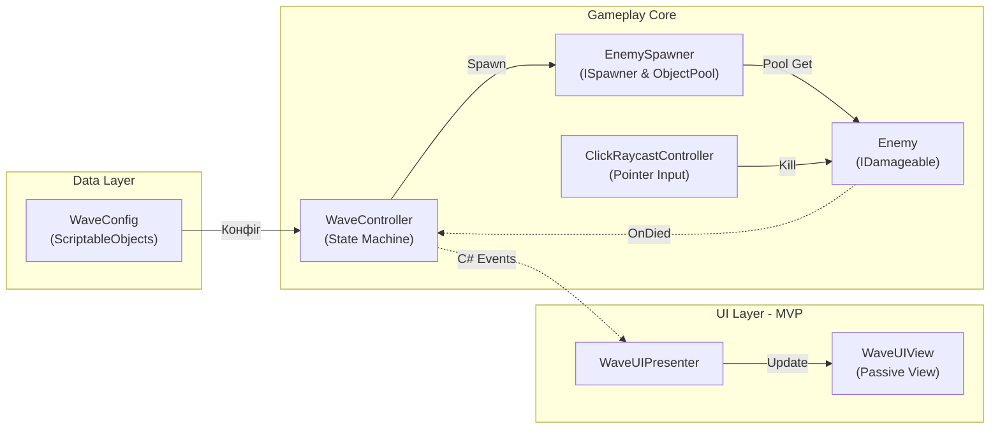

# Wave Spawner

## Запуск
- Основна сцена: `Assets/Scenes/MainScene.unity`.
- Генерація сцени та асетів з нуля: меню `Tools -> Wave Spawner -> Setup Assets and Scene`.

## Схема взаємодії

## Архітектурні рішення та їх вибір
- **Пул об'єктів (`UnityEngine.Pool`):** штатний пул замість `Instantiate`/`Destroy` та самописних списків. Усуває GC-спайки під час спавну і захищає від подвійного повернення об'єкта (`collectionCheck`).
- **UI через MVP (Passive View):** в'юшка (`WaveUIView`) лише відображає стан і нічого не знає про логіку гри. Це дозволяє змінювати верстку або перенести UI на UI Toolkit без правок у геймплейному коді.
- **Data-Driven налаштування (ScriptableObject):** параметри хвиль (`WaveConfig`, `WaveSequenceConfig`) винесені окремо від коду сцени, а валідація в `OnValidate` запобігає некоректним значенням ще до запуску.
- **Слабка зв'язаність через C# Events:** системи взаємодіють через звичайні події замість прямих залежностей або `UnityEvent` з оверхедом рефлексії.
- **Кліки через New Input System:** обробка через `Pointer.current` з перевіркою `IsPointerOverGameObject`, що блокує кліки по ворогах крізь інтерфейс.

## Точки розширення
- **Різні типи ворогів:** спавнер підтримує оверрайд префабів під окремих мобів чи босів через конфіг хвилі.
- **Бойова система:** взаємодія побудована на `IDamageable` з пошуком через `GetComponentInParent` (підтримка складних моделей з кількома колайдерами).
- **DI-фреймворки:** презентер взаємодіє з інтерфейсом `IWaveUIView` і легко переноситься під Zenject або VContainer як чистий C# клас.
- **Асинхронність (UniTask):** у тестовому використані корутини (через обмеження на сторонні асети), але для продакшену логіка затримок та спавну легко переводиться на UniTask.
