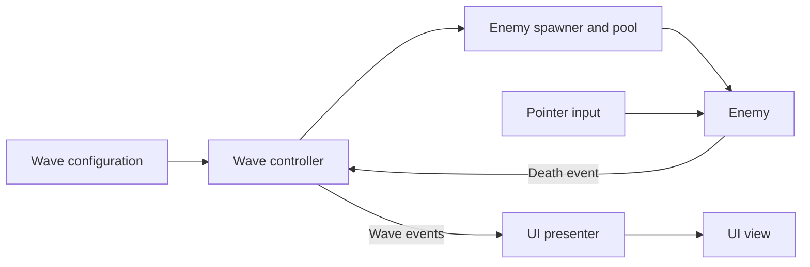

# Wave Spawner

A small Unity / C# portfolio subsystem for configurable enemy waves. It demonstrates wave sequencing, pooled enemy spawning and event-driven UI presentation.

## Implemented systems

- ScriptableObject configurations for individual waves and their sequence.
- A wave lifecycle covering spawning, waiting for enemies to be cleared and delays between waves.
- Round-robin spawn points and Unity's `ObjectPool<Enemy>` for the default enemy prefab.
- Pointer-based damage through the Input System.
- An MVP-based UI: the presenter listens to controller events and updates the view.

## Code to review

- [WaveController](Assets/WaveSpawner/Scripts/Waves/WaveController.cs): sequencing and wave events.
- [EnemySpawner](Assets/WaveSpawner/Scripts/Spawning/EnemySpawner.cs): pooling and spawn-point selection.
- [Wave data](Assets/WaveSpawner/Scripts/Data).
- [UI presenter and view](Assets/WaveSpawner/Scripts/UI).
- [Pointer input](Assets/WaveSpawner/Scripts/Player/ClickRaycastController.cs).

## Open the project

1. Open with **Unity 6000.3.25f1** and let Unity resolve its packages.
2. Open `Assets/Scenes/MainScene.unity` and enter Play Mode.
3. Inspect the scene's wave sequence, spawn points and UI bindings to explore the subsystem.

## Scope and trade-offs

This is a subsystem showcase, not a complete game. Object pooling reuses enemy instances, but does not make the whole system allocation-free: the wave controller creates `WaitForSeconds` objects during execution. No frame-rate or GC benchmark is claimed.

The controller currently references the concrete `EnemySpawner`; the repository also contains an `ISpawner` interface. This remains a prototype-level dependency rather than a fully abstracted spawning boundary.
